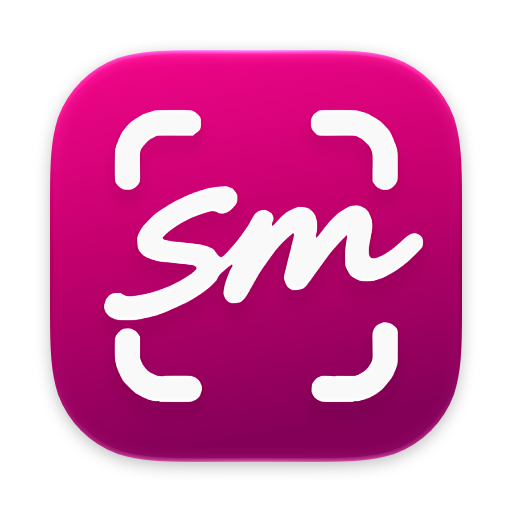

<p align="center">
  
</p>

<h1 align="center">Snapmark</h1>

<p align="center">
  <b>Capture. Mark. Share.</b><br>
  A tiny, native screenshot annotator for macOS.
</p>

<p align="center">
  <a href="https://github.com/lucas-azambuja/snapmark/releases"></a>
  
  
  <a href="LICENSE"></a>
</p>

<p align="center">
  <a href="https://github.com/lucas-azambuja/snapmark/releases"><b>Download the latest release →</b></a>
</p>

---

Press **⌘⇧5**, drag over what you want, point it out with arrows, shapes, text or blur, and copy it. Snapmark is a single native app with no dependencies: it lives in the menu bar, stays out of the Dock, and gets out of your way.

> **Status: alpha.** It works for daily use but still has rough edges. [Bug reports](https://github.com/lucas-azambuja/snapmark/issues) are welcome.

## At a glance

- 📸 **Area, window and full-screen capture** with one shortcut (⌘⇧5 by default, configurable)
- 🎯 **Adjustable selection** with handles, a **loupe**, and **snap to edges** of what's on screen
- 🔁 **Remembers the last area** for repeated captures
- ⏱️ **Screenshot timer** (3, 5 or 10 s) and **copy or save** in one click
- 🔤 **Copy text (OCR)** from any part of the screen, on-device
- ✏️ **Annotation editor**: arrows, lines, shapes, pen, highlighter, blur, text and numbered counters, all editable afterwards
- 🎥 **Screen recording** to MP4 with system audio and microphone, live audio meters and a dimmed background
- ✂️ **Review recordings**: filmstrip trimmer, per-track waveforms, volume and mute, then *Trim and Save*
- 🪟 **Floating thumbnail** to drag captures and recordings into any app
- ⚙️ **Settings** for the shortcut, save folder, image format, recording frame rate and more
- 🔔 **Update check** against GitHub releases, right from the menu bar
- 🪶 Native, tiny, no dependencies, no account, no network except the update check

See [Features](#features) for the details.

## Features

### Capture
- **⌘⇧5** dims the screen; the area you drag stays clear, with its size shown next to it.
- A **crosshair and loupe** show the pixels under the cursor, with coordinates and hex color (macOS 14+).
- **Snap to edges** (macOS 14+): while you draw, resize or move the selection, its sides snap to the visible edges on screen (windows, cards, panels, dividers), with an accent guide line. Press **G** or click *Snap* in the hint bar to turn it on or off; hold **⌥ Option** to skip it for one drag.
- **Space** switches to window capture: the front window is highlighted right away, and hovering highlights another one. **Hold Shift** to pick a whole screen.
- Nothing is captured until you say so. The selection stays on screen: drag its corners or edges to resize it, or drag it to move it. Then use the action bar next to it:

  | Action | Key |
  |---|---|
  | Capture and open the editor | `Return` (or double-click) |
  | Copy straight to the clipboard | `⌘C` |
  | Copy the **text** in the area (OCR) | `⌘⇧C` |
  | Save straight to disk | `⌘S` |
  | Record the screen | `R` |
  | Screenshot timer: off, 3, 5 or 10 seconds | `T` |
  | Cancel | `Esc` |

- A hint bar at the bottom of the screen shows the available keys while you choose.
- Keeps the full Retina resolution. Windows are captured without their shadow.

### Record
- The action bar has two groups: **Video** (system audio, microphone, Record) and **Screenshot** (timer, copy text, copy, save, capture). The timer only applies to screenshots.
- **Screen recording** of an area, a window or a whole screen, saved as MP4 (H.264, up to 60 fps) with the cursor.
- Optional **system audio** and **microphone** (macOS 15+), each with a live level meter. The arrow next to the microphone picks the input device.
- A 3-second countdown (capture warms up during it, so the recording starts sharp and with sound), then the screen stays dimmed around the recorded area (clicks still go through), and a floating control shows the elapsed time, live audio meters, **Stop** and **Discard**. Clicking the menu bar icon or pressing ⌘⇧5 also stops.
- When it's done, a **review window** opens with a filmstrip timeline: drag its ends to trim (the frame under the handle shows in the player), click or drag in the middle to scrub, and press Space to play the trimmed range. Once trimmed, the range and final length are shown and **Save** becomes **Trim and Save**. Each audio track (desktop audio and microphone) shows its **waveform**, with a **volume** slider and **mute**; the waveform follows the volume, the trim and the playhead. Then **Save** (or Discard).

### Annotate

| Tool | Key | | Tool | Key |
|---|---|---|---|---|
| Select | `V` | | Pen | `P` |
| Arrow | `A` | | Highlighter | `H` |
| Line | `L` | | Blur | `B` |
| Rectangle | `R` | | Text | `T` |
| Ellipse | `O` | | Counter (1, 2, 3…) | `N` |

- **Everything stays editable.** Select an annotation to move it, drag its handles to resize it, or pick another color or stroke. Double-click text to edit it. **⌫** deletes, arrow keys nudge (Shift for 10 pt).
- New annotations are selected as soon as you draw them, so you can tweak them right away.
- 8 colors plus a custom picker, and 4 stroke widths shown as live previews.
- **Shift** snaps lines to 45° and makes rectangles and ellipses square.
- **⌘Z / ⇧⌘Z** undo and redo every change.

### Share
- In the editor, **Return** or **⌘C** copies to the clipboard and closes it. **⌘S** saves as PNG or JPEG.
- A **floating thumbnail** slides in after copying, saving or recording: drag it into any app, or click it to reopen the image (or play the recording).
- **Open Image in Editor…** annotates any image you already have.

### And also
- A guided screen for the Screen Recording permission.
- A translucent dark editor with short, snappy animations.
- **Settings** (menu → *Settings…* or ⌘,): the capture shortcut, launch at login, sounds, update checks, remembering the last area, snapping, the loupe, window shadows, the save folder and image format (PNG or JPEG), and the recording frame rate and cursor.
- **Remembers the last area**: the next capture starts with the previous selection already in place (unless it was a whole screen), ready to capture with Return or adjust.
- *About Snapmark*, version and build number in the menu, and a daily check for new releases (**Check for Updates…**).

## Requirements

- macOS 13 (Ventura) or later
- Apple silicon or Intel

## Installation

1. Go to [**Releases**](https://github.com/lucas-azambuja/snapmark/releases) and download `Snapmark-<version>.zip` from the newest release (under *Assets*).
2. Open the downloaded `.zip` (Finder unzips it) and drag **Snapmark.app** into your **Applications** folder.
3. Open Snapmark from Applications. Its icon shows up in the menu bar; there's no Dock icon.

**First launch.** Snapmark isn't signed with an Apple Developer certificate yet, so macOS blocks it the first time with a message saying it can't verify the app. To allow it, either:

- Open **System Settings → Privacy & Security**, scroll down to the message about Snapmark, and click **Open Anyway** (then confirm).
- Or run this once in Terminal:
  ```bash
  xattr -d com.apple.quarantine /Applications/Snapmark.app
  ```

**Checking the download (optional).** Each release also has a `.sha256` file. In Terminal, in the folder with both files:
```bash
shasum -a 256 -c Snapmark-*.zip.sha256
```

### Updating

Snapmark checks GitHub for new releases once a day (you can turn this off in Settings). When there's one, the menu bar icon gets a small dot and the menu shows **Update Available**; click it to open the release. You can also use **Check for Updates…** in the menu.

To update, quit Snapmark, download the new `.zip`, and replace the app in Applications. Your settings are kept. Because the new build has a different signature, macOS asks for the Screen Recording permission again: if Snapmark already looks enabled there, remove it with **–** and allow it again.

## First run

### 1. Free up ⌘⇧5

macOS uses ⌘⇧5 for its own screenshot tool. To let Snapmark have it, turn off the system shortcut:

**System Settings → Keyboard → Keyboard Shortcuts… → Screenshots →** uncheck **"Screenshot and recording options"**.

If the shortcut is still taken, the Snapmark menu shows it as *unavailable*. You can still capture from the menu, or pick another shortcut in Settings.

### 2. Allow Screen Recording

On launch, Snapmark checks for the **Screen Recording** permission. If it's missing, a window walks you through it, with a button that opens the right place in System Settings. Once you turn it on, the window notices and lets you start.

## Development

The code is in [`Sources/`](Sources), one file per area (model, rendering, canvas, editor, selection overlay, permission screen, app). There's no Xcode project: `build.sh` calls `swiftc` directly and assembles the `.app`. It needs the Xcode Command Line Tools; with full Xcode installed, it also compiles the Icon Composer icon in [`assets/AppIcon.icon`](assets/AppIcon.icon), which keeps the icon magenta when macOS shows dark icons.

```bash
./build.sh                    # builds build/Snapmark.app (universal binary)
./build.sh --run              # builds and runs without installing
./build.sh --run image.png    # builds and opens the image straight in the editor
./build.sh --install          # builds and installs to /Applications
```

`--run image.png` is the fastest way to work on the editor: no screen capture or permission needed. To test capturing, use `--install`: macOS only lists apps for Screen Recording when they're in Applications.

Only one copy of the app can register ⌘⇧5 at a time. `--run` and `--install` quit any running Snapmark first.

macOS ties the Screen Recording permission to the app's signature. With ad-hoc signing, every build has a different signature, so each new build asks for the permission once. To avoid that, create a local certificate once with `./scripts/create-dev-cert.sh`; `build.sh` then signs every build with it.

### How it works

- **Global shortcut:** Carbon's `RegisterEventHotKey`, which doesn't need the Accessibility permission.
- **Capture overlay:** transparent windows on every screen draw the dimming, with a cutout over the area, window or screen being captured. Windows come from `CGWindowListCopyWindowInfo` and are captured with `screencapture -l`; full screens are captured after the overlay is gone.
- **Recording:** ScreenCaptureKit streams the frames (and audio) into `AVAssetWriter`. Snapmark's own windows, like the outline and the controls, are left out of the recording. The image is captured with `screencapture -R` while the overlay is still up (nothing covers the selected area), and only then does the overlay fade out. Animation timings live in `enum Motion`.
- **Editor:** an `NSView` draws the image and the annotations with Core Graphics. Annotations are stored in image pixel coordinates, so the export is always at full resolution regardless of the window's zoom.
- **Loupe:** when the overlay opens, ScreenCaptureKit takes a still picture of each display (excluding Snapmark's own windows); the loupe magnifies that picture. The crosshair and loupe are hidden right before the capture.
- **Blur:** Core Image (pixelate, then Gaussian blur), clipped to the marked area.
- **Snap to edges:** the same still picture is turned into a brightness map. Near each side of the selection, Snapmark looks for a line where the brightness jumps along most of that side, and moves the side onto it.
- **Copy text:** Vision's on-device text recognition (no network), with automatic language detection. Lines are kept in reading order; text on the same row, like table cells, is separated by tabs.

### Publishing a release

1. Update the [`VERSION`](VERSION) file.
2. Write the notes in `release-notes/<version>.md`.
3. Commit and run `./release.sh`.

The script builds the app, creates the `.zip` and its checksum, creates and pushes the `v<version>` tag, and publishes the release with the [GitHub CLI](https://cli.github.com/). Versions with a suffix (like `0.1.0-alpha.0`) are published as pre-releases.

## Known limitations

- No GIF export yet.

## Contributing

Issues and pull requests are welcome. For bigger changes, please open an issue first so we can talk it through.

## License

[MIT](LICENSE)
