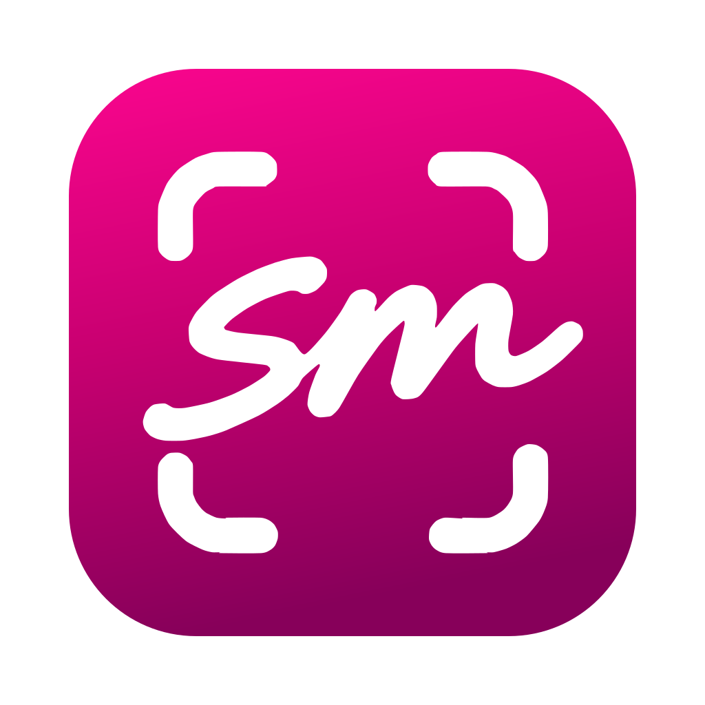

<p align="center"></p>

# Snapmark

Screenshot annotation for macOS. Press **⌘⇧5**, select an area, and point out what matters with arrows, shapes, text, or blur. Then copy or save it.

It's a small native app with no dependencies, written in Swift with AppKit. It lives in the menu bar and stays out of the Dock.

> **Status: alpha.** It works for daily use but still has rough edges. Bug reports are welcome.

## Features

- **Area capture** with ⌘⇧5. The screen dims and the area you drag stays clear, with its size shown next to it. Esc cancels; the space bar switches to window capture.
- Short animations: the dimming fades in, the captured area flashes, and the editor grows out of it.
- **Annotation editor** on a translucent dark window:

  | Tool | Key |
  |---|---|
  | Select | `V` |
  | Arrow | `A` |
  | Line | `L` |
  | Rectangle | `R` |
  | Ellipse | `O` |
  | Pen (freehand) | `P` |
  | Highlighter | `H` |
  | Blur (pixelate + blur) | `B` |
  | Text | `T` |
  | Counter (1, 2, 3…) | `N` |

- **Every annotation stays editable.** Click it with the Select tool to move it, drag its handles to resize it, or pick another color or stroke to change it. Double-click text to edit it. Delete (⌫ or the trash button) removes it, and the arrow keys nudge it (Shift for 10 pt).
- A new annotation is selected right after you draw it, so you can adjust it straight away.
- 8 preset colors plus a custom color picker, and 4 stroke widths shown as stroke previews.
- **Shift** keeps lines and arrows at 45° angles and makes rectangles and ellipses square.
- **⌘Z** undoes and **⇧⌘Z** redoes any change, including moves and edits.
- **⌘C** (or Return) copies to the clipboard and closes the editor. **⌘S** saves as PNG or JPEG.
- **Esc** clears the selection, or closes the editor (asking first if there are unsaved annotations).
- Keeps the Retina resolution of the capture.
- Opens existing images in the editor (menu → *Open Image in Editor…*).
- *About Snapmark* and the version/build number in the menu.
- Optional launch at login.

## Requirements

- macOS 13 (Ventura) or later
- Apple silicon or Intel

## Installation

### From a release

1. Download the latest `.zip` from [Releases](https://github.com/lucas-azambuja/snapmark/releases).
2. Unzip it and move `Snapmark.app` to `/Applications`.
3. Open Snapmark. Its icon shows up in the menu bar.

The app isn't signed with an Apple Developer certificate, so macOS blocks the first launch. To allow it, either:

- Try to open the app once, go to **System Settings → Privacy & Security**, scroll to the message about Snapmark, and click **Open Anyway**.
- Or run in Terminal:
  ```bash
  xattr -d com.apple.quarantine /Applications/Snapmark.app
  ```

### From source

Requires the Xcode Command Line Tools (`xcode-select --install`).

```bash
git clone https://github.com/lucas-azambuja/snapmark.git
cd snapmark
./build.sh --install
```

## First run

### 1. Free up ⌘⇧5

macOS uses ⌘⇧5 for its own screenshot tool. To let Snapmark have it, turn off the system shortcut:

**System Settings → Keyboard → Keyboard Shortcuts… → Screenshots →** uncheck **"Screenshot and recording options"**.

If the shortcut is still taken, the Snapmark menu shows *"⌘⇧5 shortcut unavailable"*. You can still capture from the menu.

### 2. Allow Screen Recording

On launch, Snapmark checks for the **Screen Recording** permission. If it's missing, a window walks you through it, with a button that opens the right place in System Settings. Once you turn it on, the window notices and lets you start.

## Development

The code is in [`Sources/`](Sources), one file per area (model, rendering, canvas, editor, selection overlay, permission screen, app). There's no Xcode project: `build.sh` calls `swiftc` directly and assembles the `.app`. The icons live in [`assets/`](assets); `build.sh` turns `AppIcon-1024.png` into `AppIcon.icns` and copies the menu bar icon into the app.

```bash
./build.sh                    # builds build/Snapmark.app (universal binary)
./build.sh --run              # builds and runs without installing
./build.sh --run image.png    # builds and opens the image straight in the editor
./build.sh --install          # builds and installs to /Applications
```

`--run image.png` is the fastest way to work on the editor: no screen capture or permission needed. To test capturing, use `--install`: macOS only lists apps for Screen Recording when they're in Applications.

Only one copy of the app can register ⌘⇧5 at a time. `--run` and `--install` quit any running Snapmark first.

macOS ties the Screen Recording permission to the app's signature. With ad-hoc signing, every build has a different signature, so each new build asks for the permission once. To avoid that, create a local certificate once with `./scripts/create-dev-cert.sh`; `build.sh` then signs every build with it.

### How it works

- **Global shortcut:** Carbon's `RegisterEventHotKey`, which doesn't need the Accessibility permission.
- **Area selection:** transparent windows on every screen draw the dimming, with a cutout over the selection. The image is captured with `screencapture -R` while the overlay is still up (nothing covers the selected area), and only then does the overlay fade out. Animation timings live in `enum Motion`.
- **Editor:** an `NSView` draws the image and the annotations with Core Graphics. Annotations are stored in image pixel coordinates, so the export is always at full resolution regardless of the window's zoom.
- **Blur:** Core Image (pixelate, then Gaussian blur), clipped to the marked area.

### Publishing a release

1. Update the [`VERSION`](VERSION) file.
2. Write the notes in `release-notes/<version>.md`.
3. Commit and run `./release.sh`.

The script builds the app, creates the `.zip` and its checksum, creates and pushes the `v<version>` tag, and publishes the release with the [GitHub CLI](https://cli.github.com/). Versions with a suffix (like `0.1.0-alpha.0`) are published as pre-releases.

## Known limitations

- The shortcut is fixed to ⌘⇧5.
- No full-screen capture shortcut, video recording, or OCR.

## Contributing

Issues and pull requests are welcome. For bigger changes, please open an issue first so we can talk it through.

## License

[MIT](LICENSE)
